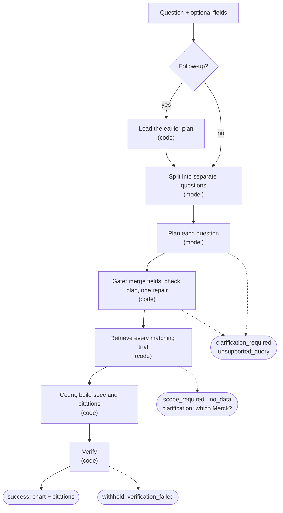
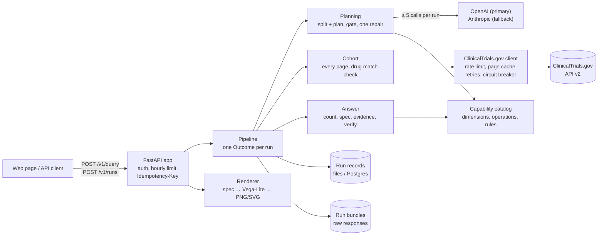
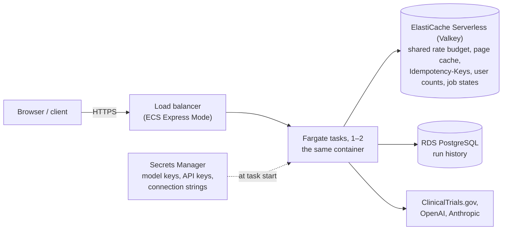

# Clinical trials question to chart

This service takes a question about clinical trials in plain English, such as "How has the number of Keytruda trials changed since 2015?", and returns a chart specification that a frontend can draw as is. The numbers come from the [ClinicalTrials.gov API v2](https://clinicaltrials.gov/data-api/api) at request time, and each bar, point, node and edge lists the trials it was counted from, with the source fields that put them there.

A hosted copy runs at https://cl-f44fdf3287b047ef971affaa8d767246.ecs.us-east-2.on.aws for the review (no key needed).

```bash
curl -s localhost:8000/v1/query -H 'content-type: application/json' \
  -d '{"query": "How has the number of trials for this drug changed over time?", "drug_name": "Pembrolizumab"}'
```

That request returns a `time_series` of trials per start year, citing 2,638 trials, and a link to the rendered PNG.

## Contents

1. [Running it](#1-running-it)
2. [How it works](#2-how-it-works)
3. [Request](#3-request)
4. [Response](#4-response)
5. [Examples](#5-examples)
6. [Design decisions](#6-design-decisions)
7. [Failures](#7-failures)
8. [Limitations and next steps](#8-limitations-and-next-steps)
9. [Testing](#9-testing)
10. [Tools, and who did what](#10-tools-and-who-did-what)

## 1. Running it

You need Python 3.13 and [uv](https://docs.astral.sh/uv/).

```bash
uv sync
cp .env.example .env    # add OPENAI_API_KEY and/or ANTHROPIC_API_KEY
uv run clinical-trials-viz serve
```

The web page is at http://127.0.0.1:8000 and the API docs at `/docs`. On the page you can ask a question, click any mark to see the trials behind it, answer clarifications, and ask follow-ups, which stack below the earlier answers. You can also ask from the command line; the chart is saved under `data/charts/`:

```bash
uv run clinical-trials-viz ask "Which countries have the most recruiting trials for melanoma?"
uv run clinical-trials-viz ask "How has the number of trials for this drug changed over time?" --fields '{"drug_name": "Pembrolizumab"}'
uv run clinical-trials-viz ask "..." --json --previous RUN_ID
uv run clinical-trials-viz replay RUN_ID     # answer a saved run again, offline, from its raw API responses
```

Settings are environment variables, all listed in [`.env.example`](.env.example). The planner defaults to `openai:gpt-5.4-mini` with `anthropic:claude-haiku-4-5` as the fallback; either can be changed there.

Tests and checks:

```bash
uv run pytest                  # offline, with saved API records
uv run pytest -m live          # against the real API
uv run python -m evals.run     # planner eval, needs a model key
uv run ruff check src tests && uv run pyright
```

Setting `DEPLOYMENT=hosted` adds Redis, Postgres, API keys (30 questions an hour per user), circuit breakers and a 30 second run deadline. `API_KEYS=you:a-long-random-key docker compose up --build` runs that mode locally. On AWS it runs on ECS Express Mode with ElastiCache, RDS and Secrets Manager; `deploy/aws/deploy.sh` sets it up and `deploy/aws/teardown.sh` removes it. See [`docs/hosted-deployment.md`](docs/hosted-deployment.md) and [`docs/reference.md`](docs/reference.md#hosted-mode-readme-1).

## 2. How it works

The language model only reads the question. Everything after that is ordinary code.



```
step                     done by
-----------------------  -------
1. load previous run     code     (follow-ups only)
2. split the message     model
3. plan each question    model
4. gate and repair       code     (repair: one model call)
5. retrieve all trials   code
6. count, build spec     code
7. verify                code
```

The first model call lists the separate questions in a message and rewrites each so it stands alone ("show their phases" becomes "show the phases of recruiting Keytruda trials in Germany"). Up to three parts are answered, each on its own. The second call turns each question into a typed Query Plan: filters, one of five operations (`aggregate`, `compare`, `per_trial`, `bin`, `relate`) and what to group by. The model never sees trial records, and it never produces a number, a trial ID or a citation.

The gate merges in the structured fields, checks the plan against the capability catalog (`catalog.py`) and, if needed, asks the model for one repair. Retrieval then fetches every matching trial from the API. If a question matches more than 20,000 trials the service asks you to narrow it rather than sample. The exception is a plain total with no grouping, drug or sponsor: there the registry's own count is the answer, and the citation is the API request itself. Counting follows written rules: a trial with two phases counts under both, a trial counts once per country, and a drug filter keeps only trials where the drug is an intervention, not just mentioned.

Code picks the chart from the plan. A question with no grouping gets a `single_value`; counts over start years a `time_series`; other breakdowns a `bar_chart`, or a `grouped_bar_chart` when a second dimension or a comparison crosses them. Enrollment distributions get a `histogram`; per-trial questions a `table`, `timeline` or `scatter_plot`; relationships a `network_graph` (lead sponsors, investigators or sites linked to drugs, or drugs given together in the same arm).

Before anything is returned, a verifier recounts every datum from its cited trials, re-reads each cited value from the trial record, checks each cited trial meets the filters, and checks the chart matches the plan. If any check fails, the answer is withheld.

A run uses two model calls in the usual case and five at most. Every run ends in one outcome: `success`, `no_data`, `clarification_required`, `unsupported_query`, `scope_required`, `upstream_error` or `internal_error`.

### System design

The service is one Python process (FastAPI) with three outside dependencies: the model providers, ClinicalTrials.gov, and in hosted mode Redis and Postgres. Everything that decides a number sits inside the process, in code that can be tested offline.



What the design is built to guarantee, and where:

- **Numbers come only from the registry.** The model sees the question, never trial records, and its output is a typed plan that code checks against the catalog. Counting, chart choice and citations are plain code (`answer.py`, `analyze.py`, `spec_builder.py`).
- **Every answer is checked before it leaves.** The verifier re-derives each count and cited value from the trial records; a failed check withholds the answer (`verify.py`).
- **Cost and time are bounded.** At most five model calls per run, counted in one ledger (`ledger.py`); 20 s per model attempt and 60 s for planning; a 30 s request deadline when hosted, with `POST /v1/runs` for questions that need longer.
- **Failures are contained.** Every exception becomes one outcome with a structured error (`failures.py`); the fallback model covers a provider outage; circuit breakers stop calling a dependency that keeps failing; one part of a multi-part question failing leaves the others answered.
- **One source of rules.** The capability catalog (`catalog.py`) feeds the planner prompt, the plan gate, counting, the verifier and the tests, so adding a dimension is one entry ([worked example](docs/project-guide.md#6-where-to-make-common-changes)).
- **Runs can be checked later.** Each run keeps its plan and response, and locally its raw API responses, so `replay` can answer it again offline.

Hosted, the same container runs on AWS in us-east-2:



Redis is shared so that every instance stays inside ClinicalTrials.gov's per-IP request limit together, and any instance can replay an Idempotency-Key or report a background run. If Redis fails, each instance falls back to its own counts and the service keeps answering.

[`docs/project-guide.md`](docs/project-guide.md) follows one question through the modules and says where to make common changes. The design rules and the reasons for them are in [`docs/harness-design.md`](docs/harness-design.md).

## 3. Request

`POST /v1/query`. Only `query` is required. The other fields pin a filter so the model doesn't have to find it in the question; most accept one value or a list. Unknown fields get a 422.

| Field | Type | Notes |
|---|---|---|
| `query` | string | 1–1,000 characters |
| `drug_name` | string or list | up to 5; brand and code names work (Keytruda, MK-3475); fills in "this drug" |
| `condition` | string or list | up to 5 |
| `trial_phase` | enum or list | `EARLY_PHASE1`, `PHASE1`–`PHASE4`, `NA` |
| `sponsor` | string or list | up to 10 lead sponsor names, matched exactly |
| `country` | string or list | up to 10; countries with a current site; USA and UK are accepted |
| `status` | enum or list | ClinicalTrials.gov overall status, e.g. `RECRUITING` |
| `start_year`, `end_year` | integer | 1990 to five years ahead |
| `nct_id` | string or list | up to 20 |
| `previous_run_id` | string | for a follow-up, a correction or a clarification answer |

Keywords, study type and "any sponsor" vs "lead sponsor" come only from the question. If a field and the question disagree (the question says phase 3, the field says phase 2), the service asks which you meant instead of picking one.

`POST /v1/query` also takes an optional `Idempotency-Key` header, and in hosted mode an `X-API-Key`; [`docs/reference.md`](docs/reference.md#idempotent-retries-and-api-keys-readme-3) has the rules. For a question that may take long, `POST /v1/runs` takes the same body, returns at once with a run ID, and `GET /v1/runs/{id}/status` reports `running`, `failed` or `done` with the response; these runs are not held to the hosted 30 s deadline. Other endpoints: `GET /v1/runs/{id}`, `GET /v1/runs/{id}/chart.png` and `.svg`, `GET /v1/runs/{id}/vega-lite.json`, `GET /v1/schema` (JSON Schemas for the request and response), `GET /health`, and the web page at `GET /`.

## 4. Response

Every outcome comes back as HTTP 200 with the outcome in the body. HTTP errors are only for requests that can't run at all.

| Field | What it holds |
|---|---|
| `run_id`, `outcome`, `message` | the result; `message` explains anything other than success |
| `visualization` | the chart specification (below), on success |
| `chart_url` | the rendered image (none for tables) |
| `evidence` | each cited trial once: title, link, the source field values that placed it, and for a keyword filter an excerpt of the text it matched |
| `assumptions` | defaults applied and data caveats |
| `applied_filters` | the filters actually used; `from_request` marks the pinned ones |
| `clarification` | on `clarification_required`: the question and options, each with its trial count |
| `suggestions` | when there is no answer: corrections counted live, or related questions |
| `error`, `warnings` | `{code, message, retryable}` on failure; problems that didn't change the answer |
| `plan`, `relation`, `planner_model` | the Query Plan, whether a follow-up refined or replaced the last one, and which model planned |
| `source`, `verification` | API version, data timestamp and counts; the verifier's checks |
| `additional_answers` | parts 2 and 3 of a multi-part question, same shape |
| `model_calls`, `timings_ms` | cost and timing |

The chart specification is our own format. Vega-Lite only draws it:

```json
{
  "type": "bar_chart",
  "title": "Trials by country: melanoma; recruiting",
  "subtitle": "485 trials",
  "encoding": {
    "x": {"field": "country", "type": "nominal", "title": "Country"},
    "y": {"field": "trial_count", "type": "quantitative", "title": "Trials"}
  },
  "data": [{"country": "United States", "trial_count": 248, "trial_ids": ["NCT00001823", "..."]}, "..."],
  "metadata": {"sort": "data_order", "top_n": 10, "other_bucket": true, "multi_valued": true, "cohort_size": 485}
}
```

Rows arrive in display order and nothing is left for the renderer to aggregate. Every row carries `trial_ids`, and where it shows a count, the count equals the number of IDs. The shape of `data` per chart type:

| `type` | One row per |
|---|---|
| `single_value` | the count (above 20,000 trials, the registry's count: `metadata.counted_by` is `registry`, the citation is `metadata.source_query`) |
| `bar_chart` | category (or comparison side) |
| `grouped_bar_chart` | category and group (`"A only"`, `"B only"`, `"Both"`) or series |
| `time_series` | start year, with `estimated_count`; no gaps |
| `histogram` | enrollment bin and type (actual or estimated) |
| `table`, `timeline`, `scatter_plot` | trial |
| `network_graph` | `{"nodes": [...], "edges": [...]}`, each with `trial_ids` |

[`docs/reference.md`](docs/reference.md#one-real-datum-of-each-chart-type-readme-4) has one real row of each type.

Citations use the field/value form the assignment allows. A row lists its trials; `evidence` describes each trial once, however many rows cite it. For the China bar in example 02:

```json
{"nct_id": "NCT03340506", "title": "Dabrafenib and/or Trametinib Rollover Study",
 "url": "https://clinicaltrials.gov/study/NCT03340506",
 "fields": {
   "protocolSection.statusModule.overallStatus": "RECRUITING",
   "protocolSection.contactsLocationsModule.locations.country": ["United States", "Argentina", "...", "China", "..."],
   "derivedSection.conditionBrowseModule.meshes.term": ["Melanoma", "..."]}}
```

These are the values behind the trial's bar (country) and each filter (status, condition). The verifier re-reads all of them from the record before answering.

## 5. Examples

[`examples/`](examples/) has nine real runs against the live API, unedited: the request, the full response and the chart. 01–05 are the submitted examples; 06–09 cover the remaining chart types. Run `uv run python -m examples.generate` to regenerate them.

| | Question | Result |
|---|---|---|
| 01 | "How has the number of trials for this drug changed over time?" + `drug_name: Pembrolizumab` | `time_series`, 2,638 trials |
| 02 | "Which countries have the most recruiting trials for melanoma?" | `bar_chart`, 485 |
| 03 | "Compare phases for trials involving semaglutide vs tirzepatide" | `grouped_bar_chart`, 849 |
| 04 | "Show a network of sponsors and drugs for glioblastoma trials" | `network_graph`, 52 links citing 978 of 2,278 trials |
| 05 | "What phases are Merck's trials in?" | asks which Merck: Merck Sharp & Dohme (2,160), Merck KGaA (275) or both (2,435) |
| 06 | "What is the enrollment distribution of breast cancer trials?" | `histogram`, 16,950 |
| 07 | "Show a timeline of recruiting phase 3 Keytruda trials in Germany" | `timeline`, the 50 most recent of 55 |
| 08 | "Plot enrollment against duration for completed semaglutide trials" | `scatter_plot`, 313 |
| 09 | "Which drugs are most often combined with pembrolizumab?" | `network_graph`, 60 links citing 1,788 of 1,817 trials |

All nine example questions in the assignment's appendix work. The planner eval (`evals/questions.json`) tests each kind with other drugs, conditions and wording:

| | Question type | Chart | How it's counted | Eval cases |
|---|---|---|---|---|
| Q-01 | trials for a drug per year | `time_series` | start year; estimated starts shown separately; empty years kept at zero | trend-01, -02, -05 |
| Q-02 | trials per year for a condition | `time_series` | the API's condition search is trusted | trend-03, -04 |
| Q-03 | a condition's trials by phase | `bar_chart` | a multi-phase trial counts under each phase | dist-01, -02 |
| Q-04 | most common intervention types | `bar_chart` | a trial counts once per type | dist-03, -04 |
| Q-05 | phases for drug A vs drug B | `grouped_bar_chart` | "A only", "B only", "Both", so nothing is counted twice | cmp-01, -02 |
| Q-06 | sponsor types across two conditions | `grouped_bar_chart` | lead sponsor class, with an overlap group | cmp-03, -04 |
| Q-07 | countries with most recruiting trials | `bar_chart` | once per country with a current site; top 10 plus Other | geo-01, -02, series-02 |
| Q-08 | sponsor and drug network | `network_graph` | lead sponsor to drug; links need 2+ trials | net-01, -03 |
| Q-09 | drugs used together | `network_graph` | same arm, not just same trial; "A or B" arms excluded | net-02 |

Beyond the appendix, investigators and sites can be linked to drugs the same way (net-04, net-05), and trials can be counted by age group (age-01).

Following one bar from source to chart, using example 02: the model's plan is "aggregate by country, condition melanoma, status recruiting". Code turns that into one API request (`query.cond=(melanoma)&filter.overallStatus=RECRUITING`), which reports 485 matches, and fetches all 485. Each trial is counted once under every country where it has a current site, which puts 59 under China. That row is `{"country": "China", "trial_count": 59, "trial_ids": ["NCT03340506", ...]}`, and the evidence for NCT03340506 above shows why it's there. All nine verifier checks passed.

## 6. Design decisions

A fixed workflow, not an agent. The only judgement in the problem is reading the question, so the model does that and nothing else. Cost stays between two and five calls, every stage can be tested on its own, and the model has no way to make up a number. The price is flexibility: a new kind of question needs a new operation in the catalog.

The model never sees trial data. That rules out invented counts and stops trial text from steering the model. It also means the model can't offer real sponsor or drug names in a clarification, so code builds those options from the data.

Live data, no local copy. Answers match today's registry, and the page cache is keyed on the API's data timestamp. Broad questions are slower (about 1.1 s per 1,000 trials), and past 20 pages the service asks you to narrow the question.

Our own chart format. The frontend gets a documented contract that doesn't depend on a charting library, and since Vega-Lite never aggregates, every number on screen traces back to its citations. The cost is maintaining the format and its renderer, network layout included.

Strict on drugs, trusting on conditions. 11% of the API's drug-search matches only mention the drug, so a drug filter keeps trials where the drug is an intervention. Condition search is broad on purpose (basket trials count). The difference is written into each answer's assumptions, with the number of trials excluded.

Drug identity from MeSH terms. Pembrolizumab appears under 503 spellings. MeSH terms also cover procedures like radiotherapy, so they are matched only to drug-type interventions.

Combinations mean the same arm. 34% of drug pairs in the same trial are in different arms (drug vs comparator). Within an arm, wording like "cisplatin or carboplatin" or "investigator's choice" is read as alternatives. On the pembrolizumab question this cut cisplatin plus carboplatin from 113 trials to 49. It's text matching, so an arm that never names both drugs is taken as given together.

Ask only when there is no sensible default. "Year" means start year and "sponsor" means lead sponsor, and both are stated as assumptions rather than asked. "Merck" or "PD-1 inhibitors" get a question with options counted from the data.

Follow-ups through `previous_run_id`. There is no conversation memory on the server. The earlier plan is loaded from the run record, and the client keeps the thread.

Raw responses kept per run. Every ClinicalTrials.gov response a run used is saved with it (`data/bundles`), so `replay` can answer it again offline and show whether anything changed. The bundles cost disk space, so they are off when hosted until object storage exists.

Hosted mode by configuration. One codebase runs with local files by default and with Redis, Postgres and API keys when hosted. Each store has two implementations to keep in step; both are tested.

pydantic-ai's `FallbackModel` with tool-based output. Models change through configuration. OpenAI and Anthropic were run; Gemini is wired in but was never tried. The fallback only covers provider errors, so a weak plan from the primary is repaired, not re-asked elsewhere.

## 7. Failures

Any failure ends in one outcome with an `error` of `{code, message, retryable}` and is logged with the run ID. Provider error bodies never reach the client. In a multi-part question, one part failing leaves the others answered.

If the main model fails, the fallback answers and the response carries a warning. If every model fails or times out (20 s per attempt, 60 s for planning), the run stops before fetching anything. ClinicalTrials.gov errors are retried with backoff, honouring `Retry-After`. A chart that can't be drawn keeps the answer and drops the image. An answer that fails verification is withheld. Every failure point is listed in [`docs/reference.md`](docs/reference.md#every-failure-point-readme-7).

## 8. Limitations and next steps

- Grouped questions, and totals with a drug or sponsor, still stop at 20,000 trials: their counts need every record. A plain total uses the registry's own count instead, and slow questions can run in the background (`POST /v1/runs`).
- The API rate-limits. The client allows 40 requests a minute, shared through Redis when hosted.
- Drug classes like "PD-1 inhibitors" become a clarification listing the drugs most often found in matching trials. The registry has no class membership to check against.
- Bad data is passed through, not corrected. One melanoma record lists 2,953,748 participants. Investigator and site names are free text: degrees and initials are removed, but one hospital written two ways is still two nodes.
- Run bundles are kept on local disk only; hosted runs have none until object storage is added.
- The eval has 66 questions plus 12 held out. `gpt-5.4-mini` scored 65/66 and 64/66 on the working set at first; both misses were adversarial (a site map by latitude and longitude was answered instead of refused, and "no longer recruiting" kept not-yet-recruiting trials), and the prompt now covers both. With that prompt it scored 66/66, and 11/12 on the held-out set: "JAK inhibitor trials" was answered instead of asking which drugs, a case that passed in 5 of 5 reruns (2026-10-27). On the earlier 46 questions it scored 46/46, 45/46, 45/46 and 46/46; `claude-haiku-4-5` got 40 of an earlier 42 and was not rerun. The industry-vs-academic comparison was right in 11 of 12 runs after the gate learned to ask for the sponsor-category split (4 of 5 before).
- Hosted: circuit breakers and the image cache are per instance, there are no migrations yet (one table), and traces aren't exported on AWS by default: `TRACES=xray` adds a collector that sends them to X-Ray (built, not yet run; see `docs/hosted-deployment.md`). The 30 s deadline applies only to `POST /v1/query` when hosted.
- Maps and efficacy questions are not supported.

## 9. Testing

Before designing anything I checked each filter against the live API. Local counts match the API's own totals exactly on the 2,968-trial pembrolizumab search (start year 2020: 263, Phase 3: 367, Germany: 326, recruiting: 712). The findings are in [`docs/research/api-data-guide.md`](docs/research/api-data-guide.md).

There are 329 offline tests, mostly through the HTTP API, with a scripted planner and saved real API records. They cover every chart type, clarifications, follow-ups, every failure point, the hosted mode, and the counting rules, some with property tests. A set of tamper tests changes a count, moves a trial to the wrong bar or alters a citation, and checks that the verifier catches it. Seven more tests run against the live API, and every answer type was run end to end with the real models and the images checked by eye.

A second model reviewed the code. Ten of its findings were real bugs; each was fixed with a test that failed first. Many other fixes came from running the service on real data: procedures counted as drugs, HTTP 429s, unreadable network images, "A or B" arms read as combinations, and multi-part questions being merged. The full list is in [`docs/reference.md`](docs/reference.md#what-the-tests-cover-readme-9).

## 10. Tools, and who did what

Tools: Claude Code as the coding assistant; pydantic-ai with an OpenAI model (primary) and an Anthropic model (fallback) for planning; Vega-Lite through `vl-convert` for charts; uv, ruff, pyright and pytest; Docker and the AWS CLI for the hosted version.

I directed the work and made the design decisions. I chose what to research, and the assistant researched it and laid out the options. The decisions are recorded in [`docs/harness-design.md`](docs/harness-design.md) and [`docs/hosted-deployment.md`](docs/hosted-deployment.md). Among them: the sample questions are only examples, so follow-ups, corrections and multi-part questions had to work; filters come from the question and structured fields override them; live data only; our own chart format with counting kept out of the charting library; networks modelled on a gene-network viewer I'd used, built on drugs, sponsors and conditions because the registry has no gene data; OpenAI first with Anthropic as fallback; no MCP, graph database or CI; a working local version before any hosting.

The assistant wrote most of the code, tests and docs to that design, and the expected plans for the eval, which I reviewed. I ran the outputs and looked at the charts. Problems I found, such as unreadable charts, follow-ups replacing earlier answers and pasted API keys being rejected, went back as fixes. I ran the AWS deployment myself step by step; the assistant wrote the scripts and diagnosed the first deployment's failures.
